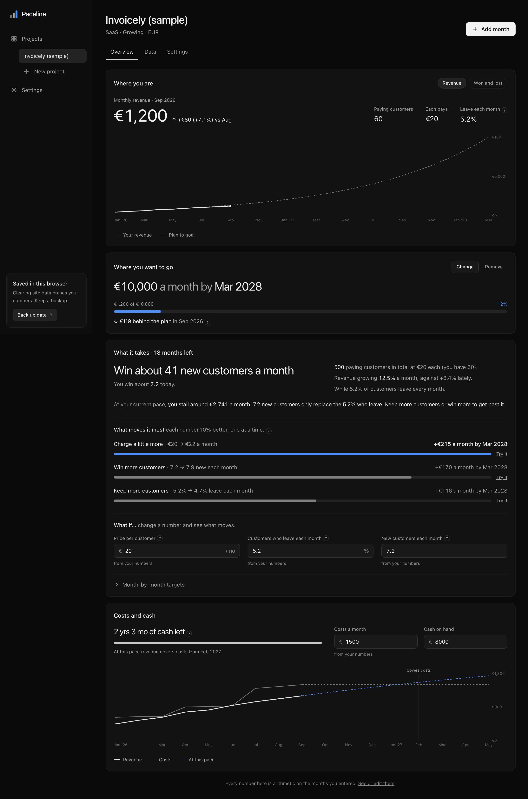
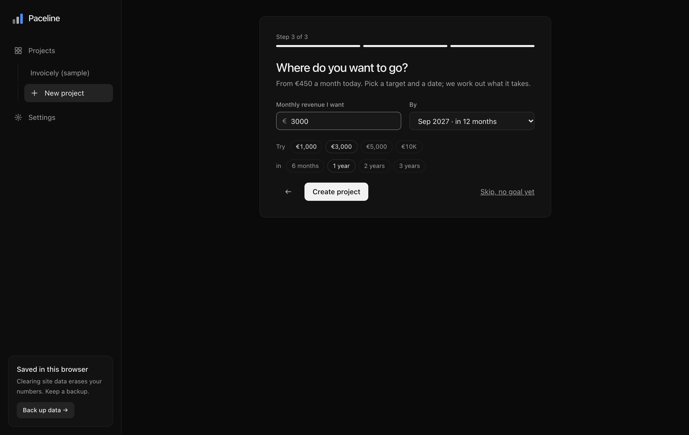
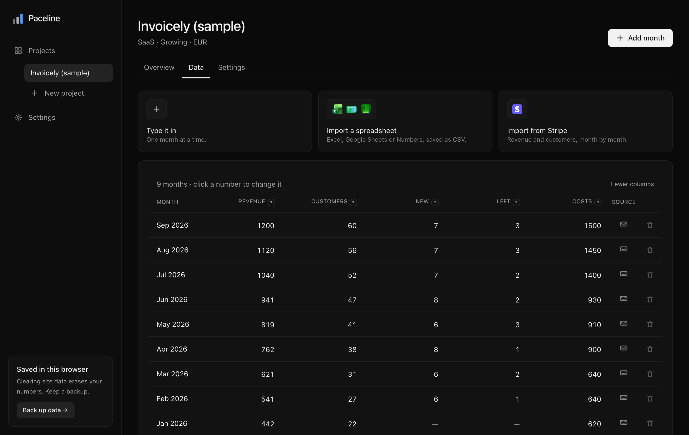
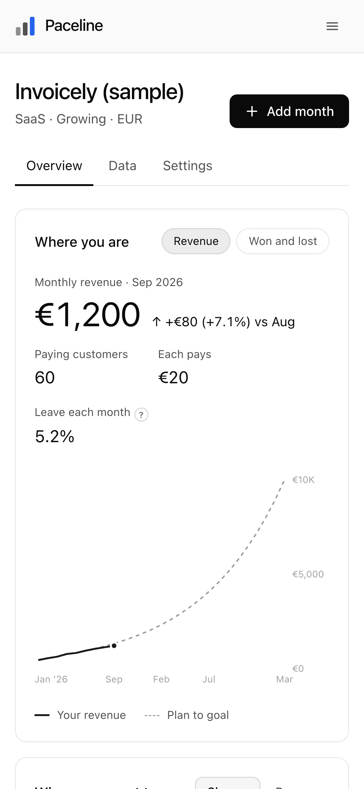

# Paceline

**See what it takes to reach your revenue goal.** A planning tool for founders
of small SaaS products and apps: put in your monthly revenue and paying
customers, pick a target like "€10k a month by next year", and see how many
customers you need, what churn is costing you, and when you get there at
today's pace.



## What it does

- **One page, three questions.** *Where you are* (revenue, customers, what each
  pays, how many leave), *where you want to go* (a goal with a plan line to
  compare every month against), *what it takes* (new customers needed per
  month, where growth stalls, runway and break-even).
- **What moves it most.** Each lever (price, new customers, churn) made 10%
  better, one at a time, ranked by how much revenue it adds by the deadline.
- **"What if" numbers.** Change price, churn or new customers per month and
  watch the date move. One click goes back to the measured values.
- **Costs and cash.** Runway from costs and cash on hand, and the month
  revenue covers costs at the current pace.
- **A plan, not a prediction.** Every number is arithmetic on months the user
  entered; values that aren't measured are labelled as guesses; real months
  (bars) and projections (dashed lines) never look alike.
- **Three ways in.** Type a month in a two-field dialog, import a spreadsheet
  (CSV with column detection, EU/US number formats, English/Italian month
  names, preview with per-row errors), or rebuild the history from Stripe
  subscriptions with a read-only key that is never stored.
- **Works without an account.** Data stays in the browser (IndexedDB) with a
  JSON backup. Signing in (email link, no password) syncs it to Postgres, and
  projects made before signing in can be moved into the account.
- **AI assistant, pay per question.** Ask about the numbers; for every "what
  if" the model calls the app's own plan engine as a tool, so the chat and the
  page agree. Optional web search with cited sources for competitor questions.
  Credits are reserved before the call and refunded if it fails.
- **Guided setup**, plain language with "?" explanations for the jargon, dark
  and light themes, keyboard and screen-reader friendly (WCAG AA, tested).

| Setup | Data | Phone, light theme |
|---|---|---|
|  |  |  |

## How the plan works

The engine ([`src/plan`](src/plan)) is a set of pure, tested functions. It
models customers, not a growth rate, because that is what a founder can act on:

```
customers(t+1) = customers(t) × (1 − churn) + new customers per month
revenue(t)     = customers(t) × revenue per customer
```

From the last months it measures revenue per customer, churn (from customers
who left, or a labelled default) and new customers per month (counted, or
estimated from the net change). From those and the goal it derives, in closed
form: customers needed, new customers needed per month to make the deadline,
the month the goal is reached at the current pace or the ceiling where new
customers only replace the ones who leave (`new / churn`), the plan line
(constant compound growth from the month the goal was set), runway and
break-even.

## Architecture

```
Browser ──────────────────────────────────────────────┐
  Screens (React, client)                              │
     │  getStorage() ── local: IndexedDB (Dexie)       │  signed out
     │              └── cloud: Supabase Postgres ──────┼─ signed in, RLS
     │  plan engine (pure functions)                   │
     └─ /api/assistant (stream) ───────────────────────┘
Server (Next.js route handlers)
  /api/assistant      reads the project as the user, reserves credits,
                      streams Claude, runs run_plan, logs usage, refunds
  /api/stripe/import  user's restricted key → monthly snapshots (not stored)
  /api/credits/checkout + /api/stripe/webhook   credit packs, idempotent
  /auth/confirm       email sign-in links
```

Decisions worth knowing:

- **One storage interface, two implementations.** Screens never talk to a
  database; [`src/storage`](src/storage) picks IndexedDB or Supabase from the
  session. Same IDs (client-side UUIDs) on both sides, so moving data into an
  account is an upsert.
- **The browser talks to Postgres directly**, safely: every table has Row
  Level Security (`user_id = auth.uid()`, and children must belong to your
  project). The credit ledger is read-only for users; only the server, with
  the service role, reserves, refunds and records purchases.
- **Money is integer cents; months are `YYYY-MM` strings.** Derived values are
  computed, never stored.
- **Credits are a ledger of movements**, not a balance column: the balance is
  a sum, a purchase is idempotent on the Stripe session id, a refund is
  idempotent on the request id.
- **Every optional service degrades gracefully.** With no environment
  variables the app is fully usable offline-first; `/api/status` tells the UI
  what is switched on.

## Stack

Next.js 16 (App Router) · TypeScript · Tailwind CSS 4 · Zod · Dexie ·
Recharts · Supabase (Auth, Postgres) · Stripe · Anthropic Claude
(`claude-opus-5-5`) · Vitest · Playwright + axe · GitHub Actions.

## Run it

```bash
npm install
npm run dev        # http://localhost:3000
```

That's all you need: accounts, the assistant and credit sales are optional
and switch on from environment variables. [`.env.example`](.env.example) lists
them; [`docs/setup.md`](docs/setup.md) walks through Supabase, Anthropic,
Stripe and deploying on Vercel.

| Command | What it does |
|---|---|
| `npm run dev` | Dev server |
| `npm run build` | Production build |
| `npm test` | Unit tests: engine, imports, Stripe MRR, database (RLS, credits) on PGlite, assistant route |
| `npm run typecheck` | Route types, then `tsc --noEmit` |
| `npm run lint` | ESLint |
| `npm run test:e2e` | Production build, then Playwright on desktop and mobile, with WCAG AA audits in both themes |

First run of the end-to-end tests: `npx playwright install chromium`.
CI ([`.github/workflows/ci.yml`](.github/workflows/ci.yml)) runs all of it on
every push and pull request.

## Layout

```
src/
  app/          Landing (/), app routes under (app)/, API route handlers
  assistant/    Assistant prompt, project context, run_plan tool
  components/   Screens, project page parts, assistant, account, UI kit
  config/       App name, optional services, credit prices
  domain/       Zod schemas: project, monthly snapshot, goal, levers, backup
  import/       CSV import, Stripe subscriptions → monthly numbers
  lib/          Months, money formatting, auth and Supabase clients, theme
  plan/         The plan engine (pure functions) and its tests
  server/       Server-only helpers (service status, Stripe client)
  storage/      Storage interface; local (IndexedDB) and cloud (Supabase)
supabase/       SQL migration and its database tests
e2e/            Playwright tests (and the README screenshots)
docs/           Spec, setup guide, screenshots
```
